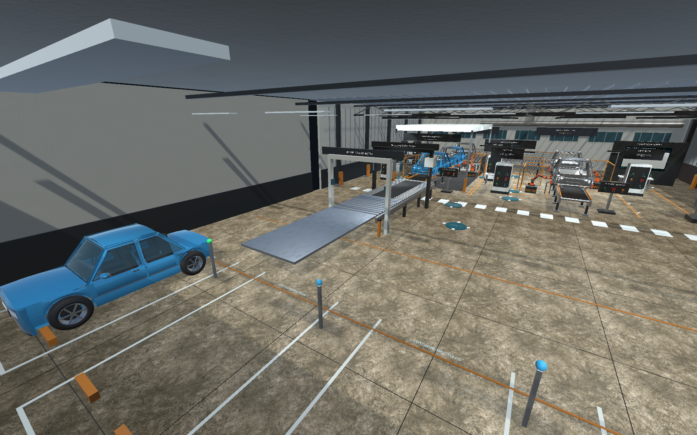
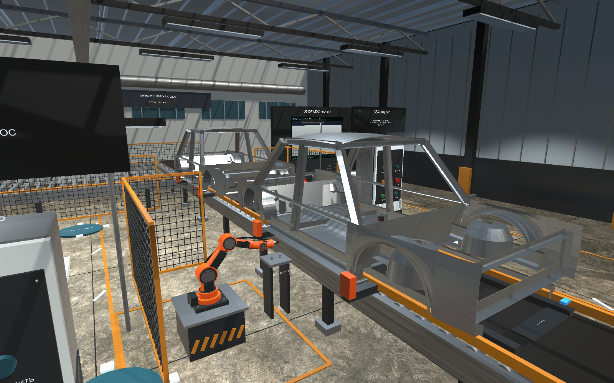
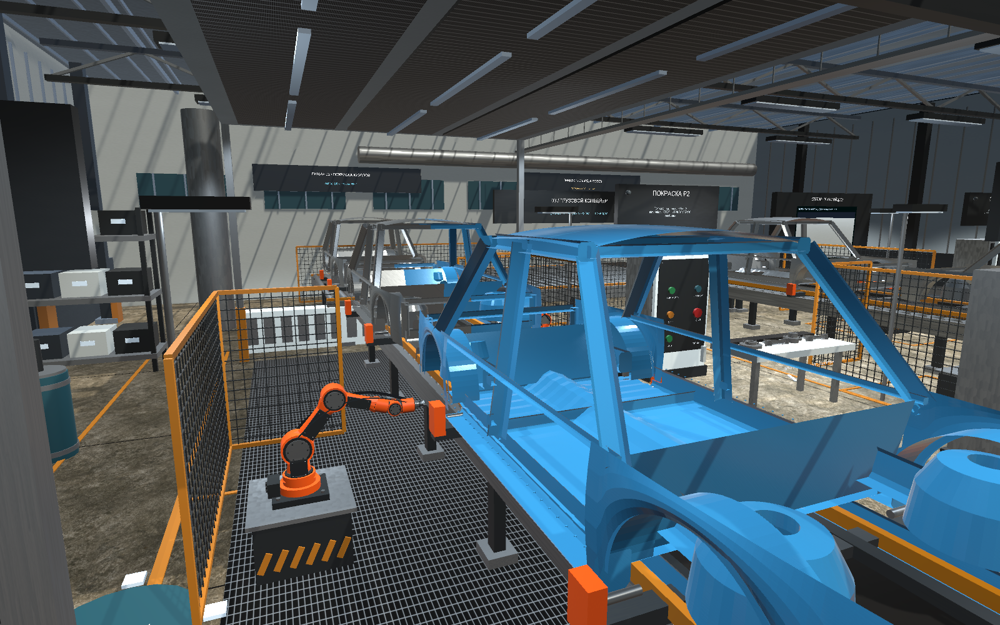
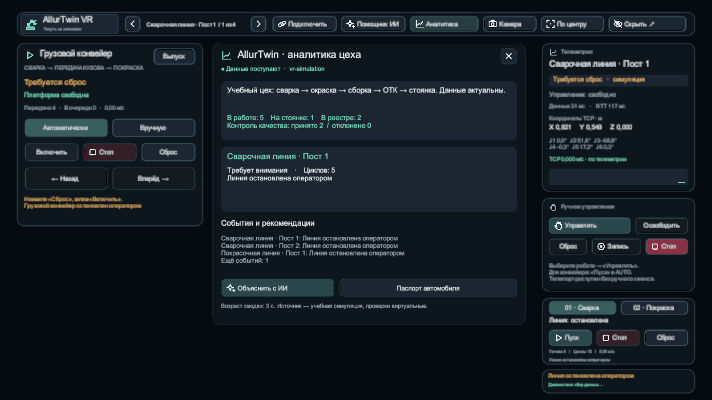
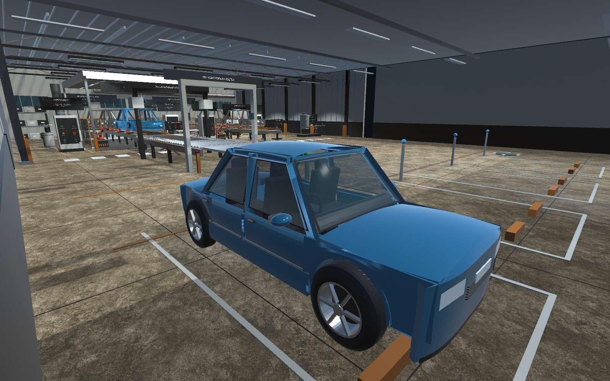
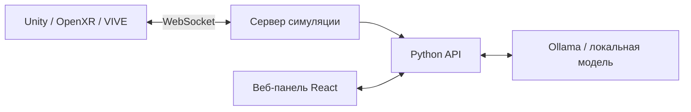

<div align="center">

# AllurTwin VR

### Учиться управлять производством — внутри виртуального цеха

**VR-симуляция • Промышленные роботы • Живые данные • Локальный ИИ**

[Презентация проекта](presentation/AllurTwin-VR-Idea-Miners.pptx) · [Запуск](#быстрый-старт) · [Возможности](#что-внутри) · [Команда](#команда)



**Ctrl Ai · Караганда, Казахстан**

</div>

## Идея

Надеть VR-очки, выбрать робота и вести его инструмент движением руки. Пройти производственный маршрут автомобиля: сварку, транспортировку, покраску, контроль качества и стоянку. Видеть состояние оборудования в очках и браузере, задавать вопросы локальному ИИ.

AllurTwin VR — учебный прототип для практики студентов и начинающих операторов. VR позволяет повторять действия с оборудованием и изучать производственный процесс в интерактивной среде.

## Что внутри

| Модуль | Возможности |
| --- | --- |
| VR-цех | Четыре манипулятора, сварочная и покрасочная линии, ручное ведение инструмента |
| Производственный маршрут | Грузовой конвейер, обработка кузовов, сборка, контроль качества и стоянка |
| Управление | Лучи контроллеров, интерактивные панели, телепортация, переключение роботов |
| Обучающий стенд | Сборка шкафа из комплектующих с проверками совместимости |
| Веб-панель | Телеметрия, состояние производства и переход к запуску VR |
| ИИ-помощник | Локальная модель через Ollama, подсказки и объяснения |

### Кадры приложения

| Сварочная линия | Покрасочная линия |
| --- | --- |
|  |  |
| **Пульт и телеметрия в VR** | **Готовый автомобиль** |
|  |  |

Все кадры выше сняты в приложении.

## Быстрый старт

Этот репозиторий содержит **исходники и презентацию**. GitHub «Download ZIP» не является готовой Windows-сборкой: Unity Player, зависимости и веса модели собираются или устанавливаются отдельно.

### Что потребуется

- Windows 10/11 x64, Git, Node.js 22+ и Python 3.12+ в PATH.
- Unity **6000.6.5f1** с модулем Windows Build Support.
- Для VR: SteamVR, настроенный OpenXR runtime и совместимый шлем. Прототип проверялся пользователем на **HTC VIVE Pro 2** со штатными контроллерами.
- Для локального ИИ: Ollama и модель `qwen3:4b`. Первичная установка требует интернета и места для весов.

```powershell
git clone https://github.com/Kavkaz228/AllurTwin-VR.git
cd AllurTwin-VR
powershell -ExecutionPolicy Bypass -File .\Setup-Symbiosis.ps1
ollama pull qwen3:4b
powershell -ExecutionPolicy Bypass -File .\Open-Unity.ps1 -Build
.\Start-Symbiosis.cmd
```

Для редактирования сцены откройте `Open-Unity.ps1` без `-Build`. Для запуска веб-части без VR:

```powershell
powershell -ExecutionPolicy Bypass -File .\Start-Symbiosis.ps1
```

Откройте **http://127.0.0.1:8089**. Локальные данные доступа создаются при первом запуске в `.local`; следуйте подсказкам запуска и смените начальный пароль. Кнопка **«Открыть VR»** запускает собранный Unity Player.

Остановка: `powershell -ExecutionPolicy Bypass -File .\Stop-Symbiosis.ps1`.

### Первые действия в очках

1. Выберите робота лучом контроллера и нажмите **«Управлять»**.
2. Если требуется — нажмите **«Сброс»**, затем отпустите кнопки.
3. Удерживайте правый курок и плавно двигайте руку: инструмент следует за ней. Отпускание останавливает ручное ведение.
4. Для телепортации удерживайте правый трекпад, наведите дугу на свободный пол и отпустите.

## Устройство проекта



| Каталог | Содержимое |
| --- | --- |
| `workshop/unity` | Unity-проект: сцена, взаимодействия, модели, текстуры, OpenXR |
| `workshop/server` | Симуляция и обмен состоянием |
| `allur/frontend` | Веб-интерфейс |
| `allur/backend` | API, данные и ИИ-интеграция |
| `packaging` | Лаунчер и инструменты создания Windows-поставки |
| `presentation` | Итоговая презентация Idea Miners |

Локальные порты: веб **8089**, API **8182**, симуляция **4182**, Ollama **11434**. Используйте стартовые скрипты: они согласуют настройки сервисов.

## Статус и дальнейшее развитие

Реализована учебная симуляция. Подключение к физическим роботам, Extend Robotics AMAS и Siemens Tecnomatix **не заявляется как готовая интеграция**. Физика и телеметрия служат учебной модели и не являются измерениями реального оборудования. ИИ помогает объяснять работу; не является промышленным контроллером безопасности.

Следующий этап — учебный пилот, оценка удобства управления и измерение результатов обучения. Для подключения настоящего оборудования потребуются отдельные адаптеры и проверка на конкретном стенде.

### Сборка переносимой версии

Инструкции: [packaging/README.md](packaging/README.md). Полная поставка включает Unity Player, Python, Node.js, Ollama и модель, поэтому занимает несколько гигабайт. Эти файлы не хранятся в Git.

## Команда

**Ctrl Ai — Караганда**

- **Забусов Андрей Викторович** — капитан команды.
- **Мурсалов Рамал Мубариз оглы** — участник команды.
- Связь с Андреем: **Telegram / WhatsApp +7 747 173 26 58**.

## Материалы и лицензии

[Скачать презентацию PowerPoint](presentation/AllurTwin-VR-Idea-Miners.pptx) · [Сторонние компоненты](THIRD_PARTY_NOTICES.md)

Наименование проекта не означает официальное партнёрство с производителем автомобилей. Права на сторонние библиотеки и материалы сохраняются за их авторами.
